# Wolinex Master Tech Stack & Merged Architecture Specification

**Document File:** `Wolinetidestack.md`  
**Platform:** Wolinex Sovereign AI Ecosystem (Unified Across Web, Desktop, Mobile & Server)  
**Target Architecture:** Multi-Task Autonomous AI Workstation  
**Core Strategy:** **Zero Coding from Scratch** — Extract and merge exclusively the pre-built, battle-tested green features from the top 5 open-source foundations.

---

## 1. Executive Summary & Market Positioning

The software industry has shifted permanently from traditional text-box code editors (Monaco/VS Code clones) to **Autonomous Multi-Task Workstations**. **Wolinex** is engineered as a single, unified brand across all platforms (Web at `:8081`, Desktop, and Mobile). 

By using the unified name **Wolinex** (and avoiding misleading suffixes like "IDE"), the platform eliminates user friction and barriers: users immediately recognize it as their complete AI companion for all tasks, rather than a niche tool reserved exclusively for software programmers:

1. **Software Developers**: Full-stack architect swarms across parallel git worktrees, Tree-sitter AST indexing for 60+ languages, `@pierre/diffs` review, and sub-second tab autocomplete.
2. **Researchers, Students & Academic Instructors**: General-purpose AI powered by Goose GDK, portable YAML Recipes for literature synthesis and data analysis, interactive MCP App widgets (charts, tables, forms inside chat), and 1,000,000-token long-horizon context with **Wolinet Max** without memory loss.
3. **Mobile App Creators**: Built-in macOS iOS Simulator and Android Emulator controls with one-click Fastlane generation of signed Google Play Store (`.aab`) and Apple App Store (`.ipa`) binaries.
4. **Non-Technical Founders & Emerging Markets (e.g. Tanzania & East Africa)**: Rapid digital adoption tools—social media automation, domain registration, secure vibe-coding, cross-device mobile approval (start on desktop, approve on iPhone/Android), and **Zero-Knowledge 1-Click Server Deploy** to VPS/Cloud via SSH or DEC 1Panel (`:9999`).

---

## 2. Foundational Architecture: Goose as Core Agent Engine

**Wolinex** uses **Goose (AAIF / Block)** as its primary foundational agent engine. Unlike traditional coding IDEs that treat AI as a secondary sidebar autocomplete, Goose provides a battle-tested, general-purpose autonomous agent runtime built in Rust for macOS, Linux, and Windows:

```
┌─────────────────────────────────────────────────────────────────────────────────────────────┐
│                          WOLINEX FOUNDATIONAL AGENT ENGINE                                  │
│                             GOOSE (AAIF / RUST GDK)                                         │
├─────────────────────────────────────────────────────────────────────────────────────────────┤
│  • Goose Development Kit (GDK): Rust runtime across desktop, CLI, servers, and resume state │
│  • General-Purpose Autonomy: Built for research, writing, automation, data & software      │
│  • Portable YAML Recipes: Reusable .yaml playbooks with subrecipes & parameter forms        │
│  • Interactive MCP Apps: Native inline UI cards (dynamic SVG charts, forms, data tables)    │
│  • Context-Isolated Subagents: Background parallel task workers that preserve context       │
│  • Adversary Security Reviewer: Real-time interception of destructive or unsafe actions     │
└─────────────────────────────────────────────────────────────────────────────────────────────┘
                                              ▲
                                              │ (Supercharged by the 4 Specialized Candidates)
                                              ▼
┌─────────────────────┬───────────────────┬───────────────────┬───────────────┬───────────────┐
│ 1. PandaCode        │ 2. Paseo          │ 3. OpenIDEA       │ 4. Continue   │ 5. Sovereign  │
│ (Simulator & Bots)  │ (Mobile Companion)│ (Editor / AST)    │ (Autocomplete)│ (Cloud & Auth)│
├─────────────────────┼───────────────────┼───────────────────┼───────────────┼───────────────┤
│ • iOS Simulator &   │ • Native Expo App │ • Tree-sitter AST │ • Sub-Second  │ • Lango (:4000│
│   Android Emulator  │   (iOS & Android) │   (60+ Languages) │   Tab Complete│   Model Map)  │
│ • @pierre/diffs     │ • QR Device Pair  │ • Search          │ • Local 0.5B  │ • Shared Auth │
│   Side-by-Side Review   Encrypted Relay │   Everywhere <10ms│   Mitambo     │   Postgres    │
│ • Multi-Channel Bots│ • Cross-Device    │ • Dockable Tool   │   (70.6 t/s)  │ • 1-Click     │
│   (WhatsApp, TG)    │   Session Sync    │   Windows (DB)    │ • @ Context   │   DEC 1Panel  │
└─────────────────────┴───────────────────┴───────────────────┴───────────────┴───────────────┘
```

---

## 3. Master Feature Matrix: Extracted Green Features Only

| Domain | Extracted Green Feature | Originating Product | Target File / Module in Wolinex |
| :--- | :--- | :--- | :--- |
| **Agent Foundation (Core)**| **Goose Rust GDK (Goose Development Kit)**: Native cross-platform agent loop | **Goose (AAIF / Block)** | `src-tauri/src/gdk/`, `src-tauri/src/agent.rs` |
| **Workflow Engine (Core)** | **Portable YAML Recipes**: `.yaml` workflow playbooks, parameters & subrecipes | **Goose (AAIF / Block)** | `src-tauri/src/recipes/`, `src/recipes.ts` |
| **Generative Chat UI** | **Interactive MCP Apps**: Dynamic inline cards (buttons, forms, charts, tables) | **Goose (AAIF / Block)** | `src/components/mcp-apps/`, `src-tauri/src/mcp/` |
| **Agent Isolation** | **Context-Isolated Subagents**: Independent background workers | **Goose (AAIF / Block)** | `src-tauri/src/providers/subagents.rs` |
| **Security & Guard** | **Adversary Reviewer & Sandbox**: Real-time prompt injection & unsafe action guard | **Goose (AAIF / Block)** | `src-tauri/src/security/adversary.rs` |
| **Multi-Agent Swarms** | Architect + 3 Workers in isolated Git Worktrees | **PandaCode** | `src-tauri/src/architect.rs`, `src/worktrees.ts` |
| **Code Review** | Unified & split syntax-highlighted diffs (`@pierre/diffs`) | **PandaCode** | `src/turn_changes/` |
| **Mobile Hardware** | Native macOS iOS Simulator & Android Emulator inspector | **PandaCode** | `src-tauri/src/simulator/tools.rs` |
| **Communications** | Standalone Bots for Telegram, Slack, Discord, WhatsApp | **PandaCode** | `src-tauri/src/bots.rs`, `src/bots-panels.ts` |
| **Task Management** | Full Kanban Board (Pending → In Progress → Review → Done) | **PandaCode** | `src/main.ts` (Board View) |
| **Mobile Client** | Native iOS & Android Expo application with QR pairing | **Paseo** | `apps/mobile/` (`packages/app` from Paseo) |
| **Sync Daemon** | WebSocket relay daemon for multi-device sync | **Paseo** | `src-tauri/src/remote/socket.rs` |
| **Voice Interface** | Voice dictation and conversational agent mode | **Paseo** | `src/voice.ts` (Paseo Voice Controller) |
| **Code Insight** | Tree-sitter AST parsing across 60+ programming languages | **OpenIDEA** | `src-tauri/crates/tree-sitter-index/` |
| **Fast Navigation** | IntelliJ-style "Search Everywhere" (`Shift+Shift` / `Cmd+P`) | **OpenIDEA** | `src/components/search-everywhere.ts` |
| **Tool Windows** | Dockable side and bottom tool windows (Database, HTTP) | **OpenIDEA** | `src/components/tool-windows/` |
| **Inline Autocomplete** | Sub-second tab autocomplete via local model / streaming | **Continue.dev** | `src/autocomplete.ts` → Mitambo `:9997` |
| **Context Providers** | Prompt references: `@code`, `@docs`, `@terminal`, `@git` | **Continue.dev** | `src/prompt-attachments.ts` |
| **Sovereign Auth** | Unified PostgreSQL auth shared with Wolinex WebUI | **Wolinet Core**| `gateway/`, `apps/wolinex/backend/` |
| **Model Protection** | Zero-leak Lango Gateway (`Wolinet Max`, `Wolinet Pro`, `Wolinet Coder`) | **Wolinet Core**| `gateway/config.yaml`, `:4000/v1` |
| **1-Click Deployment**| Zero-knowledge SSH / DEC 1Panel deployment engine | **Wolinet Core**| `src-tauri/src/deploy/ssh_engine.rs` |

---

## 4. Deep Architectural Breakdown for the 4 User Personas

```mermaid
flowchart TD
    User["👤 Wolinex User (Unified Account)"]
    User --> P1["💻 1. Software Developers"]
    User --> P2["🔬 2. Researchers, Students & Faculty"]
    User --> P3["📱 3. Mobile App Creators"]
    User --> P4["🚀 4. Non-Technical Founders & Beginners"]

    subgraph DevStack ["Developer Engine"]
        P1 --> D1["Architect + 3 Workers (PandaCode)"]
        P1 --> D2["Tree-Sitter 60+ Languages (OpenIDEA)"]
        P1 --> D3["Side-by-Side Diffs with 1-Click Merge"]
        P1 --> D4["Fast Tab Autocomplete (Continue + Mitambo 0.5B)"]
    end

    subgraph ResearchStack ["Research & Education Engine"]
        P2 --> R1["YAML Recipes: Lit Reviews, Grading, Assignments (Goose)"]
        P2 --> R2["Interactive MCP Apps: Charts, Forms, Data Tables (Goose)"]
        P2 --> R3["1,000,000-Token Long-Horizon Memory (Wolinet Max via Lango)"]
    end

    subgraph MobileStack ["Mobile Creation Engine"]
        P3 --> M1["Live iOS Simulator & Android Emulator (PandaCode)"]
        P3 --> M2["Native Mobile Companion App (Paseo Expo)"]
        P3 --> M3["1-Click Signed .aab & .ipa Fastlane Generator"]
    end

    subgraph FounderStack ["Beginner & Emerging Market Engine"]
        P4 --> F1["Zero-Knowledge 1-Click Server Deploy (SSH & 1Panel :9999)"]
        P4 --> F2["Social Media & Domain Automation Recipes"]
        P4 --> F3["Cross-Device Freedom: Start on Mac, Approve on Phone"]
    end
```



---

### Persona 1: Software Developers
* **Architect-Worker Swarms**: An Architect agent plans the multi-file changes and delegates tasks to 3 parallel Worker agents running inside **isolated Git worktrees** (`pandacode/worktree-<id>`). Workers edit files concurrently without code collision.
* **OpenIDEA Tree-sitter Core**: Instant syntax tree evaluation across 60+ languages. Provides "Search Everywhere" (`Shift+Shift`) across symbols, classes, files, and git commits in under **10 milliseconds**.
* **`@pierre/diffs` Engine**: Clean side-by-side diff view with per-chunk staging, inline comments, and a single **"Merge into Main"** button that resolves commits locally.
* **Continue-Style Autocomplete**: High-speed inline suggestions powered by the local **Mitambo 0.5B model** (`deepseeker-coder` @ 70.6 tok/s on CPU memory bandwidth) with zero API latency.

---

### Persona 2: Researchers, Students & Academic Instructors (from Goose)
* **YAML Recipe Catalog**: Ready-to-run automation playbooks stored in `.wolinet/recipes/`:
  - `literature-synthesis.yaml`: Searches academic databases, extracts citations, and synthesizes contrasting findings.
  - `assignment-grading.yaml`: Audits student code submissions against test suites and generates constructive rubric feedback.
  - `data-cruncher.yaml`: Parses large CSV/JSON datasets, calculates statistical summaries, and prepares research posters.
* **Interactive MCP Apps**: Tools render dynamic UI widgets directly into the chat:
  - Interactive KaTeX math rendering and charts (`Chart.js` / SVG).
  - Form dialogs for setting experiment parameters without writing code.
  - Interactive data tables with sorting and CSV export.
* **1,000,000-Token Long Horizon (Wolinet Max)**: Long research papers, textbooks, and multi-chapter theses fit inside a single context window through **Wolinet Max** (flagship Gemini 2.5/3.8 long-context backend) via Lango's 1M+ token routing, eliminating memory degradation.

---

### Persona 3: Mobile App Creators
* **Embedded Hardware Simulators**:
  - Direct integration with macOS native **Xcode iOS Simulator** (iPhone, iPad) and **Android Studio Emulator** (`adb` / `xcrun simctl`).
  - The inspector window mirrors the mobile device screen in real time. The agent can tap buttons, verify layout responsiveness, capture screenshots for visual QA, and diagnose UI regressions.
* **1-Click App Store Packaging**:
  - Integrated Fastlane pipeline in `src-tauri/src/deploy/mobile.rs`.
  - Generates signed Android App Bundles (`.aab`) for the Google Play Console and `.ipa` archives for Apple TestFlight/App Store with automated keystore management.

---

### Persona 4: Non-Technical Founders & Beginners (Tanzania & Emerging Economies)
* **Zero-Knowledge 1-Click Server Deploy**:
  - The user simply supplies their VPS IP, SSH username, and password or key (or selects DEC 1Panel `:9999`).
  - The agent inspects the repository, generates container configurations (`Dockerfile`, `docker-compose.yml`, Nginx/Caddy SSL reverse proxy), pushes files over SFTP/rsync, starts the daemon, tests HTTP 200 health, and delivers a live public HTTPS URL.
  - Solves the biggest bottleneck for emerging digital entrepreneurs: going live with zero Linux sysadmin experience.
* **Cross-Device Mobile Freedom (Paseo Expo App)**:
  - A founder starts an automated task on their desktop at the office.
  - They pair their smartphone via a 1-second QR scan.
  - While commuting, they receive live streaming updates and push approval notifications directly on their iPhone or Android device.
* **Multi-Channel Business Bots**:
  - Built-in connectors for **Telegram, WhatsApp, Slack, and Discord**. Founders can attach an agent to their business WhatsApp or Telegram number to handle client inquiries or order lookups automatically.

---

## 5. Merging Blueprint: Code-Level Integration Strategy

To fulfill the mandate of **no building from scratch**, we import and wire existing modules directly:

```
apps/WolinetIDE/
├── src-tauri/                         # Rust Core (Native Backend Engine)
│   ├── Cargo.toml                     # Dependencies (rusqlite, tauri v2, portable-pty, reqwest)
│   ├── src/
│   │   ├── main.rs                    # Entrypoint & environment init
│   │   ├── lib.rs                     # Tauri command registry
│   │   ├── gdk/                       # [CORE BASE: GOOSE] Rust Goose Development Kit agent loop
│   │   ├── recipes/                   # [CORE BASE: GOOSE] YAML Recipe execution engine & subrecipes
│   │   ├── mcp/                       # [CORE BASE: GOOSE] MCP server integration & Interactive MCP Apps
│   │   ├── security/                  # [CORE BASE: GOOSE] Prompt injection guard & Adversary reviewer
│   │   ├── architect.rs               # [FROM PANDACODE] Multi-agent team coordinator
│   │   ├── turn_changes/              # [FROM PANDACODE] Turn snapshot & diff tracker
│   │   ├── simulator/tools.rs         # [FROM PANDACODE] iOS/Android simulator bridge
│   │   ├── bots.rs                    # [FROM PANDACODE] Telegram/WhatsApp/Discord connectors
│   │   ├── tree_sitter/               # [MERGED FROM OPENIDEA] Fast multi-language AST parser
│   │   ├── remote/socket.rs           # [MERGED FROM PASEO] WebSocket daemon for mobile pairing
│   │   ├── deploy/                    # [WOLINET SOVEREIGN] 1-Click SSH/1Panel server deployer
│   │   └── providers/
│   │       ├── wolinet.rs             # Pure Lango Gateway client (:4000)
│   │       └── subagents.rs           # [CORE BASE: GOOSE] Isolated subagent runner
│
├── src/                               # Frontend (TypeScript + CSS)
│   ├── main.ts                        # Core view controller & event router
│   ├── board.ts                       # [FROM PANDACODE] Kanban Task Board view
│   ├── worktrees.ts                   # [FROM PANDACODE] Git worktree manager
│   ├── provider-settings.ts           # Sovereign Wolinet Account & Gateway selection
│   ├── components/
│   │   ├── mcp-apps/                  # [CORE BASE: GOOSE] Interactive UI card renderer
│   │   ├── search-everywhere.ts       # [MERGED FROM OPENIDEA] Shift+Shift symbol search
│   │   └── deploy-wizard.ts           # [WOLINET SOVEREIGN] 1-Click Server Deploy modal
│   └── autocomplete.ts                # [MERGED FROM CONTINUE] Sub-second inline tab completion
│
└── apps/mobile/                       # [HARVESTED FROM PASEO] Native iOS/Android Expo client
    ├── App.tsx                        # Native mobile layout
    ├── src/components/                # Chat stream, diff review, permission approvals
    └── package.json                   # Expo / React Native configuration
```

---

## 6. Shared Database & Sovereign Model Mapping Specification

To guarantee seamless continuity between **Wolinex WebUI (`:8081`)**, **Wolinex Desktop**, and **Wolinex Mobile**:

1. **Shared PostgreSQL Database (`:5433`)**:
   - Both Web and Desktop applications authenticate against the shared `litellm` and `openwebui` PostgreSQL schema.
   - User credentials, API keys, balance credits, active sessions, and chat histories are persisted in shared platform tables.
   - When a user logs in on the Wolinex Desktop or Mobile app, their existing balance, subscriptions, and tasks from the WebUI are immediately accessible.

2. **Unified Session Sync Flow**:
   ```
   [User creates task on Wolinex WebUI :8081 or Mobile]
                     │
                     ▼
        [Task Saved in PostgreSQL :5433]
                     │
                     ▼
   [Wolinex Desktop detects active session via WebSocket/DB query]
                     │
                     ▼
   [Desktop opens task in parallel Worktree with full diffs & local tools]
   ```

3. **Sovereign Flagship Model Mapping (Zero External Vendor Leakage)**:
   All model requests route through **Lango Gateway (`:4000/v1`)** or sovereign local inference. External vendor identities (Google, Gemini, Anthropic, Claude, Kimi, DeepSeek, OpenAI) are strictly masked:

   | Exposed UI Model Name | Sovereign Flagship Role | Upstream Backend Engine (Masked Behind Lango) | Ideal Workload |
   | :--- | :--- | :--- | :--- |
   | **`Wolinet Max`** | Long-Horizon Flagship (1M+ Tokens) | **Google Vertex Gemini 2.5 / 3.8 Pro & Flash** | Literature synthesis, full-repository comprehension, multi-chapter research, multimodal vision analysis |
   | **`Wolinet Pro`** | Advanced Reasoning Flagship | **Claude 3.7 Sonnet / DeepSeek R1** | Multi-file architectural planning, complex algorithmic logic, test-driven implementation, deep bug diagnosis |
   | **`Wolinet Coder`** | High-Speed & Local Autocomplete | **Local Mitambo 0.5B (`:9997` @ 70.6 tok/s) & DeepSeek V3** | Sub-second inline tab autocomplete, instant diff triage, rapid shell command execution, offline editing |

---

## 7. Immediate Execution Checklist

- [x] **Repository Cloned**: Canonical IDE placed directly in [`apps/WolinetIDE`](file:///Users/apple/Documents/wolinetai/apps/WolinetIDE).
- [x] **Product Manifest Registered**: `desktop-ide` mapped in [`products.json`](file:///Users/apple/Documents/wolinetai/products.json).
- [x] **Frontend & Backend Verified**: `npm run build` (6.68s) and `cargo check` (0 errors) green.
- [x] **Wolinex Unified Directory Created**: Folder [`apps/WolinexAi`](file:///Users/apple/Documents/wolinetai/apps/WolinexAi) established for unified desktop distribution.
- [ ] **Step 1: Wire Shared PostgreSQL Auth**: Replace local-only SQLite auth with PostgreSQL connection pool to share users with Wolinex WebUI.
- [ ] **Step 2: Merge Goose Recipe Runner (`.yaml`)**: Port Goose's recipe parser into `src-tauri/src/recipes/` for researcher/daily workflows.
- [ ] **Step 3: Implement 1-Click Server Deploy Wizard**: Add the SSH/1Panel deployment modal into the IDE header.
- [ ] **Step 4: Connect Paseo Mobile Expo Client**: Set up `apps/mobile/` for iPhone and Android QR-code pairing.

